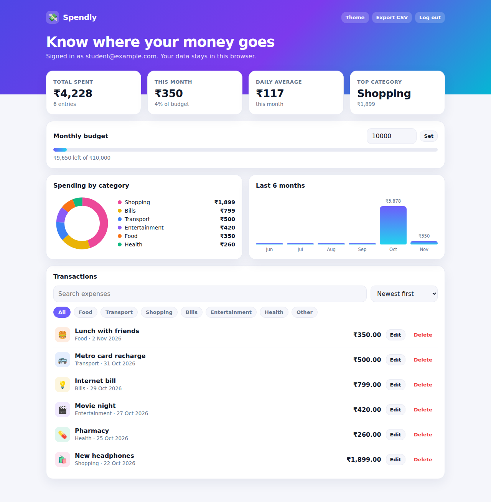
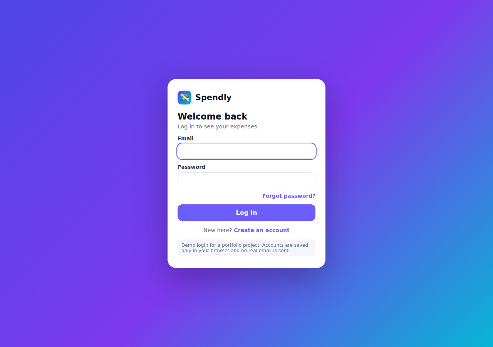
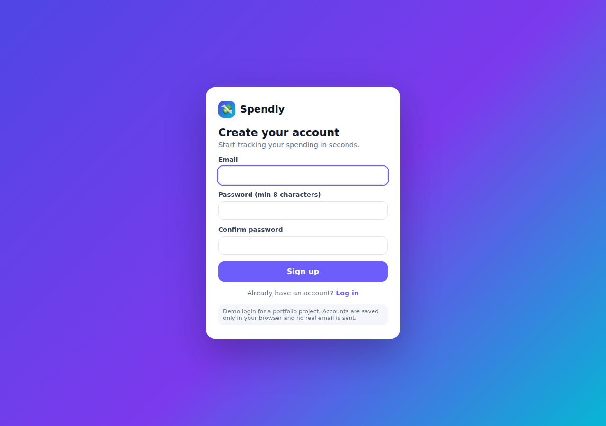
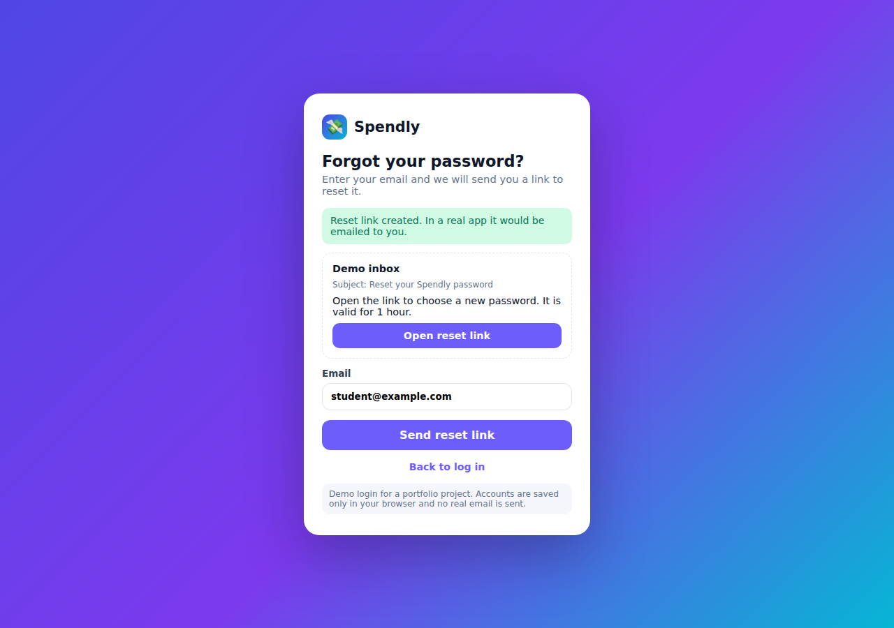

# Spendly: Expense Tracker

A responsive expense-tracking web app with a demo login flow, built with plain HTML, CSS and JavaScript (no frameworks, no build step).

> **Live demo:** _add your GitHub Pages link here after the "Publish it online" section below_
> `https://YOUR-USERNAME.github.io/spendly-expense-tracker/`



## Features
- **Login system (demo):** register, log in, log out, **forgot password** and **reset password** with a one-time link, then redirect back to login
- **Dashboard:** total spent, this-month spend, daily average and top category
- **Monthly budget** with a progress bar that turns orange and red as you approach or pass it
- **Charts:** category donut chart and a 6-month bar chart, drawn with SVG and CSS (no chart library)
- **Add, edit and delete** expenses, with search, category filters and sorting
- **Export to CSV**
- **Dark mode** (follows the system, with a manual toggle)
- **Responsive** layout for phones and desktops
- Each account has its own saved data

## Screenshots
| Login | Register | Forgot password |
|---|---|---|
|  |  |  |

## Tech stack
HTML5, CSS3 (CSS variables, grid, flexbox, media queries), vanilla JavaScript (ES6+), Web Crypto API (`SHA-256`), `localStorage`, GitHub Pages.

## Honest note about the login
This is a **front-end-only demo**. Accounts and expenses are stored in the browser's `localStorage`, passwords are salted and hashed with SHA-256, and the "reset email" is a demo inbox shown on the page. It shows the complete user flow, but it is **not real security**: anyone with access to the browser can read the stored data. A production app needs a server, a database and a real email service. (A Flask + SQLite version with real accounts is the natural next step, see "Future improvements".)

## Project structure
All files sit in one folder (no sub-folders), which keeps uploading to GitHub simple.
```
spendly-expense-tracker/
├── index.html                    # dashboard (redirects to login if you are not logged in)
├── login.html                    # log in
├── register.html                 # create an account
├── forgot.html                   # request a reset link (shows the demo inbox)
├── reset.html                    # choose a new password, then go back to login
├── styles.css                    # dashboard styles (light and dark theme)
├── auth.css                      # login-page styles
├── app.js                        # dashboard logic: data, charts, filters, CSV export
├── auth.js                       # demo authentication logic
├── screenshot-*.png              # images used in this README
└── README.md
```

## How the project was built, step by step

**Step 1. Plan the features.** Decide what a user needs: add expenses, see totals, see where money goes, set a budget, and have their own account.

**Step 2. Design the data.** One expense is a small object: `{ id, title, amount, category, date }`. The whole list is an array saved in `localStorage`. Categories (Food, Transport, Shopping, Bills, Entertainment, Health, Other) each have an icon and a colour.

**Step 3. Build the layout (`index.html`).** A gradient header, four stat cards, a budget card, two chart cards and a transactions list. The add/edit form is a native `<dialog>` element.

**Step 4. Style it (`styles.css`).** Colours are CSS variables, so dark mode only means swapping the variables. CSS grid makes the layout responsive: four cards on desktop, two on tablets, one on phones.

**Step 5. Write the logic (`app.js`).** A single `render()` function reads the list and redraws everything: totals, budget bar, charts and the filtered list. Every change (add, edit, delete, filter, search) updates the data, saves it and calls `render()`.

**Step 6. Draw the charts without a library.** The donut chart is SVG circles using `stroke-dasharray` (each category's percentage). The 6-month chart is coloured `div` bars whose heights are scaled to the largest month.

**Step 7. Add extra features.** Search and category chips filter the list, a sort menu orders it, the budget is saved, and the CSV export builds a text file in memory and downloads it.

**Step 8. Add the login flow (`login.html`, `register.html`, `forgot.html`, `reset.html`, `auth.js`).**
- *Register:* checks the email and a password of at least 8 characters, creates a random salt, hashes `salt + password` with SHA-256, and saves the account.
- *Login:* hashes the typed password with the stored salt and compares. The same error message is shown for a wrong email or a wrong password.
- *Session:* the logged-in email is saved as `spendly_session`. `index.html` checks it on load and redirects to `login.html` if it is missing.
- *Forgot password:* creates a random one-time token valid for 1 hour and shows a demo inbox with the reset link.
- *Reset password:* the link opens `reset.html?token=...`. If the token is valid, the new password is saved, the token is deleted (so it works only once) and the user is redirected to `login.html`.
- *Per-user data:* expenses are saved under a key that includes the email, so each account sees only its own data.

**Step 9. Test it.** The whole flow was tested in a real browser: log-out redirect, wrong password, register, add expense, log out, forgot password, reset, old password rejected, new password accepted, one-time link, second account cannot see the first account's data, and mobile layout.

## Run it on your computer
Easiest: double-click `login.html`.

Better (behaves like a real website): open a terminal in the project folder and run
```bash
python -m http.server 8000
```
then open http://localhost:8000/login.html

## Push the whole project to GitHub

### Method A: with the browser (no commands)
1. Log in at https://github.com and click **New repository** (https://github.com/new).
2. Repository name: `spendly-expense-tracker`. Choose **Public**. Do **not** tick "Add a README". Click **Create repository**.
3. On the new page click **uploading an existing file**.
4. Open the project folder on your computer, press **Ctrl + A** to select all 14 files, and drag them into the browser window (or click **choose your files** and select them all). Wait until every file shows in the list.
5. Click **Commit changes**.

### Method B: with Git commands (Windows PowerShell, inside the project folder)
```powershell
git init
git add .
git commit -m "Add Spendly expense tracker with demo login"
git branch -M main
git remote add origin https://github.com/YOUR-USERNAME/spendly-expense-tracker.git
git push -u origin main
```
- If Git is not installed, get it from https://git-scm.com and reopen PowerShell.
- The first push opens a browser window to sign in to GitHub. Approve it.
- If Git says "Please tell me who you are", run `git config --global user.name "Your Name"` and `git config --global user.email "you@example.com"`, then commit again.

## Publish it online for free (GitHub Pages)
1. In your repository click **Settings**, then **Pages** (left menu).
2. Under **Build and deployment**, set **Source** to **Deploy from a branch**.
3. Choose branch **main** and folder **/ (root)**, then click **Save**.
4. Wait 1 to 2 minutes and refresh. Your link appears at the top: `https://YOUR-USERNAME.github.io/spendly-expense-tracker/` (the start page is `login.html`, so open `.../login.html`, or visit `/index.html` and it redirects you).
5. Paste the link into the **Live demo** line at the top of this README and into your resume.

## Future improvements
- Real backend: Flask or Node.js API, a database (PostgreSQL), real password hashing (bcrypt) and a real email service for password resets
- Recurring expenses and bill reminders
- Charts by custom date range
- Import from CSV or bank statements
- Unit and browser tests in CI

## Resume bullets (edit to match what you did)
- Built **Spendly**, a responsive expense tracker with budgeting, search/filter, SVG charts, CSV export and dark mode using vanilla JavaScript, HTML and CSS.
- Implemented a demo authentication flow (register, login, forgot/reset password with one-time expiring tokens, salted SHA-256 hashing, per-user data isolation) and tested it end to end in a real browser.
- Deployed to GitHub Pages and documented the project with a step-by-step README.
